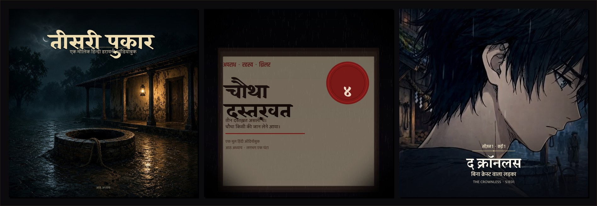
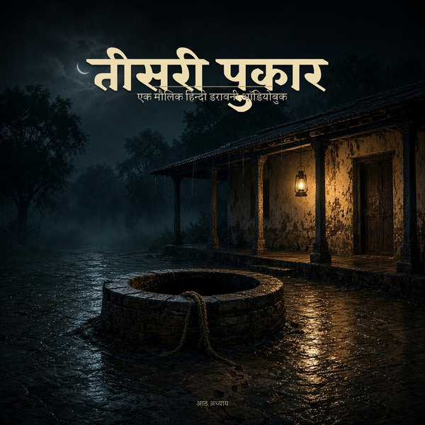
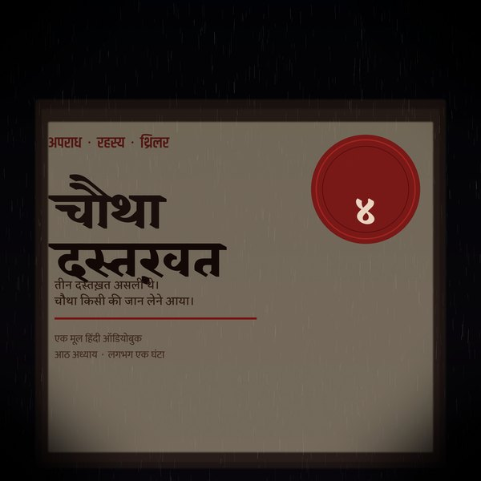
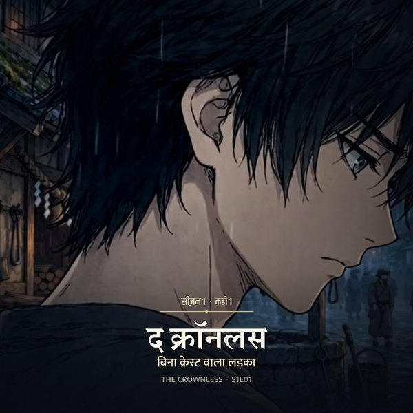

# HM Kahaniyan · एचएम कहानियाँ

<p align="center">
  
</p>

<p align="center">
  <b>मौलिक हिन्दी ऑडियोबुक और ऑडियो सीरीज़</b><br>
  Original Hindi audiobooks &amp; audio series<br>
  Horror · Crime Thriller · Fantasy
</p>

<p align="center">
  <a href="https://open.spotify.com/show/6yPuAn00jpvxNZYNBRAfDT"></a>
  <a href="https://open.spotify.com/show/2ttA6fNHucxs4OAubdZRqy"></a>
  
</p>

**HM Kahaniyan** मौलिक हिन्दी कहानियाँ बनाती है — एक कथावाचक और हर पात्र की अलग आवाज़ के साथ, असली फ़ील्ड-रिकॉर्डेड ध्वनि प्रभावों के साथ, और ऐसी पटकथा के साथ जो पहले तीस सेकंड में पकड़ ले और हर अध्याय के अंत पर ठहरा दे।

HM Kahaniyan produces original Hindi stories: a narrator plus a distinct voice for every character, real field-recorded sound, and writing built to hook you in the first thirty seconds and leave a cliffhanger at the end of every chapter.

Full-book masters are published in the **[v1.0 GitHub Release](https://github.com/ashswin-git/hm-kahaniyan-audiobooks/releases/tag/v1.0)**. Scripts, cover art, voice credits, SFX sources and 60-second previews live in this repository.

---

## Listen on Spotify

| Show | Genre | Status | Runtime | Link |
|---|---|---|---|---|
| **तीसरी पुकार** | Horror series | Ongoing · Part 3 coming soon | 1 hr 38 min · 16 chapters | [Open on Spotify](https://open.spotify.com/show/6yPuAn00jpvxNZYNBRAfDT) |
| **चौथा दस्तख़त** | Crime thriller | Complete | 58:04 · 8 chapters | [Open on Spotify](https://open.spotify.com/show/2ttA6fNHucxs4OAubdZRqy) |
| **Crownless S1E01** | Fantasy | Spotify coming soon | 48:57 · 8 chapters | Coming soon |

Catalog total (published audio): **about 3 hours 25 minutes.**

---

## 1. तीसरी पुकार · Teesri Pukar

<p align="center"></p>

**जो तीसरी पुकार का उत्तर देता है, सुबह उसकी खड़ाऊँ मुंडेर पर मिलती है — शरीर नहीं।**

| | |
|---|---|
| **Genre** | Hindi horror audio series |
| **Status** | Ongoing — Part 1 & Part 2 published, **Part 3 coming soon** |
| **Runtime** | Part 1: 46:36 · Part 2: 51:22 · **Total 1:37:58** (16 chapters) |
| **Listen** | [Spotify](https://open.spotify.com/show/6yPuAn00jpvxNZYNBRAfDT) · [60s preview](books/teesri-pukar/preview_60s.mp3) · [Book folder](books/teesri-pukar/) |

### Synopsis (spoiler-free)

सिन्धुवाड़ा के पुराने प्राथमिक विद्यालय के पिछवाड़े एक वर्षों से बंद कुआँ है। अध्यापिका अन्वी अमावस की रात तीन पुकारों का नियम सुनती है: जो तीसरी पुकार का उत्तर देता है, सुबह उसकी खड़ाऊँ मुंडेर पर मिलती है — शरीर नहीं। पुकार अक्सर उसी के स्वर में आती है।

भाग २ में कहानी यहीं से चलती है। तारक बहन की खड़ाऊँ और डायरी के साथ गाँव में रहता है, कुआँ उसका नाम गिनने लगता है, और गाँव का पुराना समझौता धीरे-धीरे खुलता है। अध्याय १६ एक क्लिफहैंगर पर रुकता है — भाग ३ आने वाला है।

Behind the old primary school in Sindhuwada sits a well that has been sealed for years. On a moonless night, the teacher Anvi learns the rule of three calls: whoever answers the third call is found the next morning only as a pair of wooden sandals on the well’s parapet — never the body. The voice that calls often sounds like one’s own. Part 2 continues from that ending. Part 3 is coming soon.

### Chapters

**भाग १ · Part 1 (46:36)**

| # | शीर्षक | Duration |
|---|---|---|
| 1 | छत की टप-टप | 5:47 |
| 2 | बंद कुआँ | 5:51 |
| 3 | तीन पुकार का नियम | 5:59 |
| 4 | अमावस | 6:02 |
| 5 | अपना ही स्वर | 5:38 |
| 6 | गीली सीढ़ियाँ | 5:07 |
| 7 | हाँ, मैं हूँ | 5:20 |
| 8 | चाक की खड़ाऊँ | 6:52 |

**भाग २ · Part 2 (51:22)**

| # | शीर्षक | Duration |
|---|---|---|
| 9 | उसका अपना नाम | 6:22 |
| 10 | नई दीदी | 6:18 |
| 11 | कई जोड़ी खड़ाऊँ | 5:50 |
| 12 | रजिस्टर की तिथि | 6:31 |
| 13 | माँ की चुप्पी | 6:36 |
| 14 | अधूरी हाँ | 5:56 |
| 15 | दो नाम | 5:51 |
| 16 | अपनी ही खड़ाऊँ | 7:59 |

### Voice cast

| Role | Voice |
|---|---|
| कथावाचक | Devansh |
| अन्वी / पुकार | Shalini |
| तारक / प्रतिध्वनि | Tushar |
| रघुनाथ | Raghavan |
| हरिकांत | Devendra |
| कमला | Kavita |
| रमेश | Kunal |
| रेणुका | Neha |
| सुमित्रा | Usha |
| यादव | Ishan |
| धीरजा | Priti |

Full credits: [CAST.md](books/teesri-pukar/CAST.md) · scripts: [Part 1](books/teesri-pukar/script_part1_hi.txt), [Part 2](books/teesri-pukar/script_part2_hi.txt) · SFX: [SOURCES.md](books/teesri-pukar/SOURCES.md)

---

## 2. चौथा दस्तख़त · Chautha Dastakhat

<p align="center"></p>

**तीन दस्तख़त असली थे। चौथा किसी की जान लेने आया।**

| | |
|---|---|
| **Genre** | Hindi crime thriller audiobook |
| **Status** | Complete |
| **Runtime** | **58:04** (8 chapters) |
| **Listen** | [Spotify](https://open.spotify.com/show/2ttA6fNHucxs4OAubdZRqy) · [60s preview](books/chautha-dastakhat/preview_60s.mp3) · [Book folder](books/chautha-dastakhat/) |

### Synopsis (spoiler-free)

नर्मदापुर — एक काल्पनिक मध्य-भारतीय शहर — के नगर निगम रिकॉर्ड रूम में क्लर्क हरीश पंडित फाँसी पर लटकता मिला। बेल्ट नई है, पंखे के हुक पर संघर्ष के निशान हैं, और फर्श पर ऐसे पदचिह्न हैं जो हरीश के साइज़ के नहीं। बेटी इशिता, इंस्पेक्टर साक्षी वर्मा और सब-इंस्पेक्टर इमरान एक नदी-किनारे ज़मीन के दस्तावेज़ तक पहुँचते हैं: कमला बाई की ज़मीन उनकी मृत्यु के बाद बेची गई दिखती है, और गवाह के रूप में लिखे डॉक्टर प्रकाश गुप्ता आठ महीने पहले ही “मर” चुके थे। तीन दस्तख़त असली लगते हैं। चौथा किसी और का है।

In the municipal record room of Narmadapur, a fictional city in central India, clerk Harish Pandit is found hanged. The belt is new, the fan-hook shows signs of a struggle, and the footprints on the floor are not his size. His daughter Ishita, Inspector Sakshi Verma and Sub-Inspector Imran follow a riverside land document: Kamla Bai’s plot appears to have been sold after her death, and the doctor named as a witness had already “died” eight months earlier. Three signatures look genuine. The fourth belongs to someone else.

### Chapters

| # | शीर्षक | Duration |
|---|---|---|
| 1 | रिकॉर्ड रूम | 6:18 |
| 2 | आत्महत्या का नक़्शा | 6:13 |
| 3 | नदी किनारे का सौदा | 7:40 |
| 4 | अलमारी का पेनड्राइव | 6:50 |
| 5 | दूसरी मौत | 6:47 |
| 6 | लंगड़ा आदमी | 7:53 |
| 7 | चौथा दस्तख़त | 7:27 |
| 8 | फैसला | 8:56 |
| | **Total** | **58:04** |

### Voice cast

| Role | Voice |
|---|---|
| कथावाचक | Aman |
| इंस्पेक्टर साक्षी वर्मा | Priti |
| इशिता पंडित | Neha |
| सब-इंस्पेक्टर इमरान शेख़ | Ishan |
| आकाश त्रिवेदी | Rahul |
| सेठ महेश खण्डेलवाल | Devendra |
| अधीक्षक मेहता | Amit |
| डॉ. प्रकाश गुप्ता | Binit |
| रफ़ीक | Tanmay |
| हरीश पंडित | Aditya |
| ललिता | Usha |
| तहसीलदार एस. रावत | Kunal |

Full credits: [CAST.md](books/chautha-dastakhat/CAST.md) · [script](books/chautha-dastakhat/script_hi.txt) · SFX: [SOURCES.md](books/chautha-dastakhat/SOURCES.md)

---

## 3. Crownless · S1E01 — बिना क्रेस्ट वाला लड़का

<p align="center"></p>

**मुकुटों से पहले एक पुरानी दुनिया थी। फिर आए क्रेस्ट। और एक बिना निशान वाला लड़का इतिहास को फिर से चला देगा।**

| | |
|---|---|
| **Genre** | Hindi fantasy audio series |
| **Status** | Season 1, Episode 1 complete · **Spotify coming soon** |
| **Runtime** | **48:57** (8 chapters) |
| **Listen** | Spotify coming soon · [60s preview](books/crownless/preview_60s.mp3) · [Book folder](books/crownless/) |

### Synopsis (spoiler-free)

एलारियन के पश्चिमी छोर पर, राजधानी से बहुत दूर, एल्डेन नाम का एक गाँव है। यहाँ एक क्रेस्ट दरवाज़ा खोल सकता है — या उसे हमेशा के लिए बंद कर सकता है। केल वेरोन अठारह साल का है, लोहार गैरोन का पालन-पोषण पाया हुआ, और उसकी कलाई खाली है। हर साल शाही निरीक्षण वही सवाल पूछता है: तुम कौन-सी शक्ति रखते हो? केल के पास देने को कोई चिह्न नहीं, केवल यह जवाब — वह अभी भी खड़ा है।

उत्तर की सड़क पर धुआँ उठता है, पुराना मंदिर बुलाता है, और गाँव पर हमला यह बताता है कि लुटेरों को अनाज नहीं, कोई सोई हुई चीज़ चाहिए।

On the western edge of Elarion, far from the capital, lies the village of Elden. Here a crest can open a door — or close it forever. Eighteen-year-old Kael Veron was raised by the blacksmith Gaeron, and his wrist is bare. Every year the royal inspection asks the same question: what power do you hold? Kael has no mark to offer, only this answer — he is still standing. Smoke rises on the northern road, an old temple calls, and a raid on the village makes it clear the attackers did not come for grain.

### Chapters

| # | शीर्षक | Duration |
|---|---|---|
| 1 | क्रेस्ट का कानून | 6:09 |
| 2 | एल्डेन की सुबह | 6:22 |
| 3 | निरीक्षण | 5:58 |
| 4 | उत्तर का धुआँ | 5:26 |
| 5 | देवदार की सड़क | 4:43 |
| 6 | गाँव में आग | 5:33 |
| 7 | छुपा हुआ सच | 5:21 |
| 8 | मंदिर के नीचे | 9:25 |
| | **Total** | **48:57** |

### Voice cast

| Role | Voice |
|---|---|
| कथावाचक | Devansh |
| केल वेरोन | Ishan |
| मीरा वेल | Ananya |
| गैरोन वेरोन | Raghavan |
| कैप्टन रस्क | Aman |
| पहरेदार | Amit |
| सिपाही | Reyansh |
| दूत | Binit |
| ग्रामीण | Kunal |
| हमलावर नेता | Devendra |
| बच्चा | Maisha |
| प्राचीन स्वर | Usha |
| अज्ञात राजकीय स्वर | Aditya |

Full credits: [CAST.md](books/crownless/CAST.md) · [script](books/crownless/script_hi.txt) · SFX: [SOURCES.md](books/crownless/SOURCES.md)

---

## How it's made · यह कैसे बनती है

1. **Original scripts / मौलिक पटकथा.** Every title is an original Hindi story written for audio: a hook in the first thirty seconds, a cliffhanger at the end of every chapter, and a twist in the close. Full scripts are in each book folder.
2. **Multi-voice Hindi narration / कई स्वर.** A narrator plus a distinct voice for each character, performed in Hindi. Cast lists name the voice used for every role (voice names only).
3. **Real CC0 field-recorded sound / असली ध्वनि.** Spot effects and ambience come from real recordings — Freesound and public-domain collections, licensed **CC0 1.0** or dedicated to the public domain — not synthetic, grid-like loops. Rain and wind beds stay low so the voice stays dominant. Horror and thriller mixes add real drones, risers, stingers and related beds. Full titles, authors and source URLs:

   - [तीसरी पुकार — SOURCES.md](books/teesri-pukar/SOURCES.md)
   - [चौथा दस्तख़त — SOURCES.md](books/chautha-dastakhat/SOURCES.md)
   - [Crownless — SOURCES.md](books/crownless/SOURCES.md)

---

## Licence · लाइसेंस

Stories, scripts, mixed audio and cover artwork are **All Rights Reserved © 2026 HM Kahaniyan**. This is not an open-source licence. See [LICENSE](LICENSE).

Sound-effect recordings remain under their original **CC0 / public-domain** licences and are credited in each book’s `SOURCES.md`. Those recordings are not claimed as original works of HM Kahaniyan.

---

## Repository layout

```
├── README.md
├── LICENSE
├── assets/covers/          # 600px covers + catalog banner
├── books/
│   ├── teesri-pukar/       # scripts, CAST, cover, 60s preview, SFX credits
│   ├── chautha-dastakhat/
│   └── crownless/
```

Full-length masters and 3000×3000 covers are attached to [Release v1.0](https://github.com/ashswin-git/hm-kahaniyan-audiobooks/releases/tag/v1.0) — they are not stored in git.

**HM Kahaniyan** · 2026
