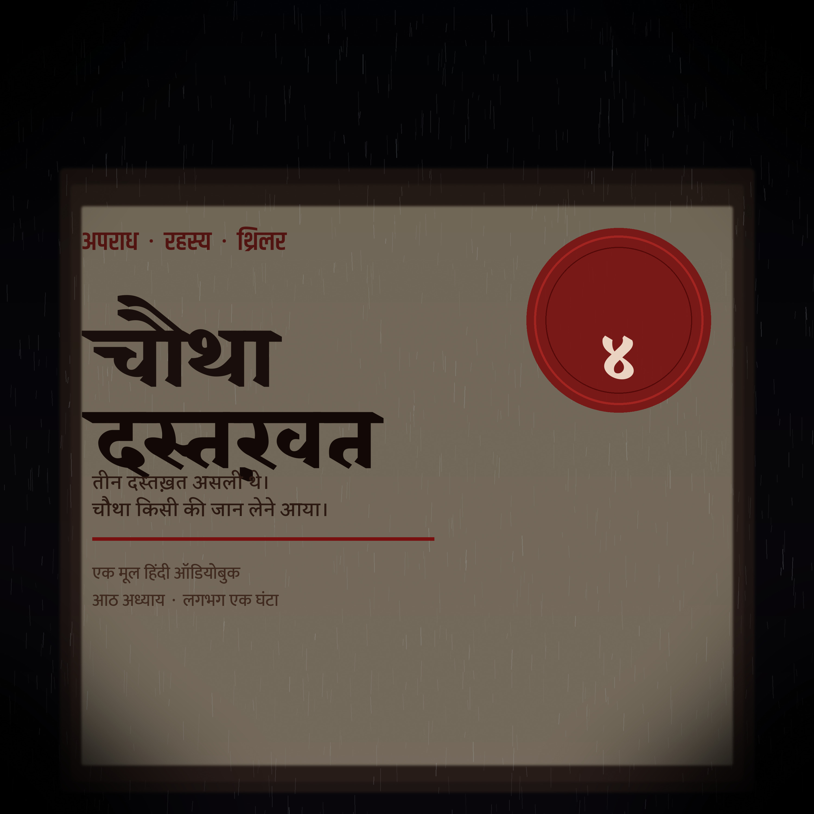

# चौथा दस्तख़त · Chautha Dastakhat

  

**HM Kahaniyan** · Hindi crime thriller audiobook · Complete

**Tagline:** तीन दस्तख़त असली थे। चौथा किसी की जान लेने आया।

- **Listen on Spotify:** [चौथा दस्तख़त](https://open.spotify.com/show/2ttA6fNHucxs4OAubdZRqy)
- **Preview:** [preview_60s.mp3](preview_60s.mp3) (60 seconds)
- **Script:** [script_hi.txt](script_hi.txt)
- **Voice cast:** [CAST.md](CAST.md)
- **SFX credits:** [SOURCES.md](SOURCES.md)
- **Full-book audio:** [GitHub Release v1.0](https://github.com/ashswin-git/hm-kahaniyan-audiobooks/releases/tag/v1.0)

## Status

A complete 8-chapter original novella. **Total runtime: 58 minutes 4 seconds.**

## Synopsis (spoiler-free)

नर्मदापुर — एक काल्पनिक मध्य-भारतीय शहर — के नगर निगम रिकॉर्ड रूम में क्लर्क हरीश पंडित फाँसी पर लटकता मिला। बेल्ट नई है, पंखे के हुक पर संघर्ष के निशान हैं, और फर्श पर ऐसे पदचिह्न हैं जो हरीश के साइज़ के नहीं। बेटी इशिता, इंस्पेक्टर साक्षी वर्मा और सब-इंस्पेक्टर इमरान एक नदी-किनारे ज़मीन के दस्तावेज़ तक पहुँचते हैं: कमला बाई की ज़मीन उनकी मृत्यु के बाद बेची गई दिखती है, और गवाह के रूप में लिखे डॉक्टर प्रकाश गुप्ता आठ महीने पहले ही “मर” चुके थे। तीन दस्तख़त असली लगते हैं। चौथा किसी और का है।

In the municipal record room of Narmadapur, a fictional city in central India, clerk Harish Pandit is found hanged. The belt is new, the fan-hook shows signs of a struggle, and the footprints on the floor are not his size. His daughter Ishita, Inspector Sakshi Verma and Sub-Inspector Imran follow a riverside land document: Kamla Bai’s plot appears to have been sold after her death, and the doctor named as a witness had already “died” eight months earlier. Three signatures look genuine. The fourth belongs to someone else.

## Chapters

| # | शीर्षक | Duration |
|---|---|---|
| 1 | रिकॉर्ड रूम | 6:18 |
| 2 | आत्महत्या का नक़्शा | 6:13 |
| 3 | नदी किनारे का सौदा | 7:40 |
| 4 | अलमारी का पेनड्राइव | 6:50 |
| 5 | दूसरी मौत | 6:47 |
| 6 | लंगड़ा आदमी | 7:53 |
| 7 | चौथा दस्तख़त | 7:27 |
| 8 | फैसला | 8:56 |
| | **Total** | **58:04** |

## Voice cast

| Role | Voice |
|---|---|
| कथावाचक | Aman |
| इंस्पेक्टर साक्षी वर्मा | Priti |
| इशिता पंडित | Neha |
| सब-इंस्पेक्टर इमरान शेख़ | Ishan |
| आकाश त्रिवेदी | Rahul |
| सेठ महेश खण्डेलवाल | Devendra |
| अधीक्षक मेहता | Amit |
| डॉ. प्रकाश गुप्ता | Binit |
| रफ़ीक | Tanmay |
| हरीश पंडित | Aditya |
| ललिता | Usha |
| तहसीलदार एस. रावत | Kunal |

See [CAST.md](CAST.md) for the full table.

## Licence

Story, script, mixed audio and cover: **All Rights Reserved © 2026 HM Kahaniyan**.  
Sound effects: CC0 / public domain, credited in [SOURCES.md](SOURCES.md).

Back to the [catalog README](../../README.md).
