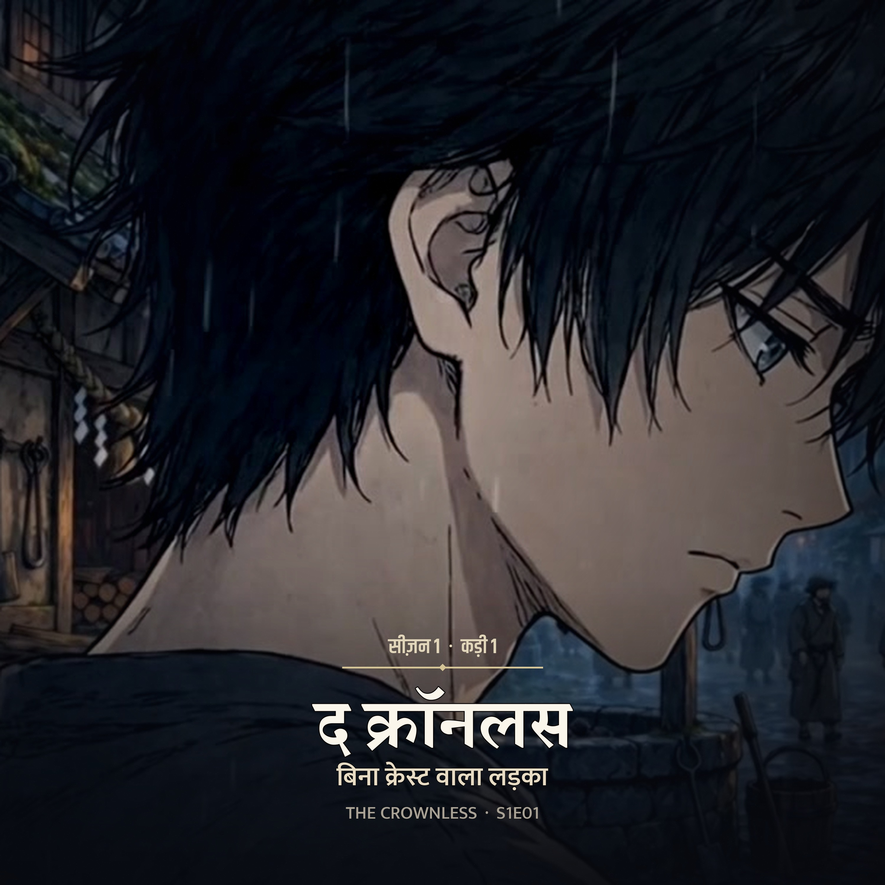

# Crownless · S1E01 — बिना क्रेस्ट वाला लड़का

  

**HM Kahaniyan** · Hindi fantasy audio series · Season 1, Episode 1 complete

**Tagline:** मुकुटों से पहले एक पुरानी दुनिया थी। फिर आए क्रेस्ट। और एक बिना निशान वाला लड़का इतिहास को फिर से चला देगा।

- **Spotify:** coming soon
- **Preview:** [preview_60s.mp3](preview_60s.mp3) (60 seconds)
- **Script:** [script_hi.txt](script_hi.txt)
- **Voice cast:** [CAST.md](CAST.md)
- **SFX credits:** [SOURCES.md](SOURCES.md)
- **Full-episode audio:** [GitHub Release v1.0](https://github.com/ashswin-git/hm-kahaniyan-audiobooks/releases/tag/v1.0)

## Status

Season 1 Episode 01 is complete: **8 chapters, 48 minutes 57 seconds.**
The Spotify show will be added here once it is live.

यह उपयोगकर्ता की मूल कथा **THE CROWNLESS** की पहली कड़ी का हिन्दी ऑडियोबुक रूपांतर है।

## Synopsis (spoiler-free)

एलारियन के पश्चिमी छोर पर, राजधानी से बहुत दूर, एल्डेन नाम का एक गाँव है। यहाँ एक क्रेस्ट दरवाज़ा खोल सकता है — या उसे हमेशा के लिए बंद कर सकता है। केल वेरोन अठारह साल का है, लोहार गैरोन का पालन-पोषण पाया हुआ, और उसकी कलाई खाली है। हर साल शाही निरीक्षण वही सवाल पूछता है: तुम कौन-सी शक्ति रखते हो? केल के पास देने को कोई चिह्न नहीं, केवल यह जवाब — वह अभी भी खड़ा है।

उत्तर की सड़क पर धुआँ उठता है, पुराना मंदिर बुलाता है, और गाँव पर हमला यह बताता है कि लुटेरों को अनाज नहीं, कोई सोई हुई चीज़ चाहिए।

On the western edge of Elarion, far from the capital, lies the village of Elden. Here a crest can open a door — or close it forever. Eighteen-year-old Kael Veron was raised by the blacksmith Gaeron, and his wrist is bare. Every year the royal inspection asks the same question: what power do you hold? Kael has no mark to offer, only this answer — he is still standing. Smoke rises on the northern road, an old temple calls, and a raid on the village makes it clear the attackers did not come for grain.

## Chapters

| # | शीर्षक | Duration |
|---|---|---|
| 1 | क्रेस्ट का कानून | 6:09 |
| 2 | एल्डेन की सुबह | 6:22 |
| 3 | निरीक्षण | 5:58 |
| 4 | उत्तर का धुआँ | 5:26 |
| 5 | देवदार की सड़क | 4:43 |
| 6 | गाँव में आग | 5:33 |
| 7 | छुपा हुआ सच | 5:21 |
| 8 | मंदिर के नीचे | 9:25 |
| | **Total** | **48:57** |

## Voice cast

| Role | Voice |
|---|---|
| कथावाचक | Devansh |
| केल वेरोन | Ishan |
| मीरा वेल | Ananya |
| गैरोन वेरोन | Raghavan |
| कैप्टन रस्क | Aman |
| पहरेदार | Amit |
| सिपाही | Reyansh |
| दूत | Binit |
| ग्रामीण | Kunal |
| हमलावर नेता | Devendra |
| बच्चा | Maisha |
| प्राचीन स्वर | Usha |
| अज्ञात राजकीय स्वर | Aditya |

See [CAST.md](CAST.md) for the full table.

## Licence

Story, script, mixed audio and cover: **All Rights Reserved © 2026 HM Kahaniyan**.  
Sound effects: CC0 / public domain, credited in [SOURCES.md](SOURCES.md).

Back to the [catalog README](../../README.md).
