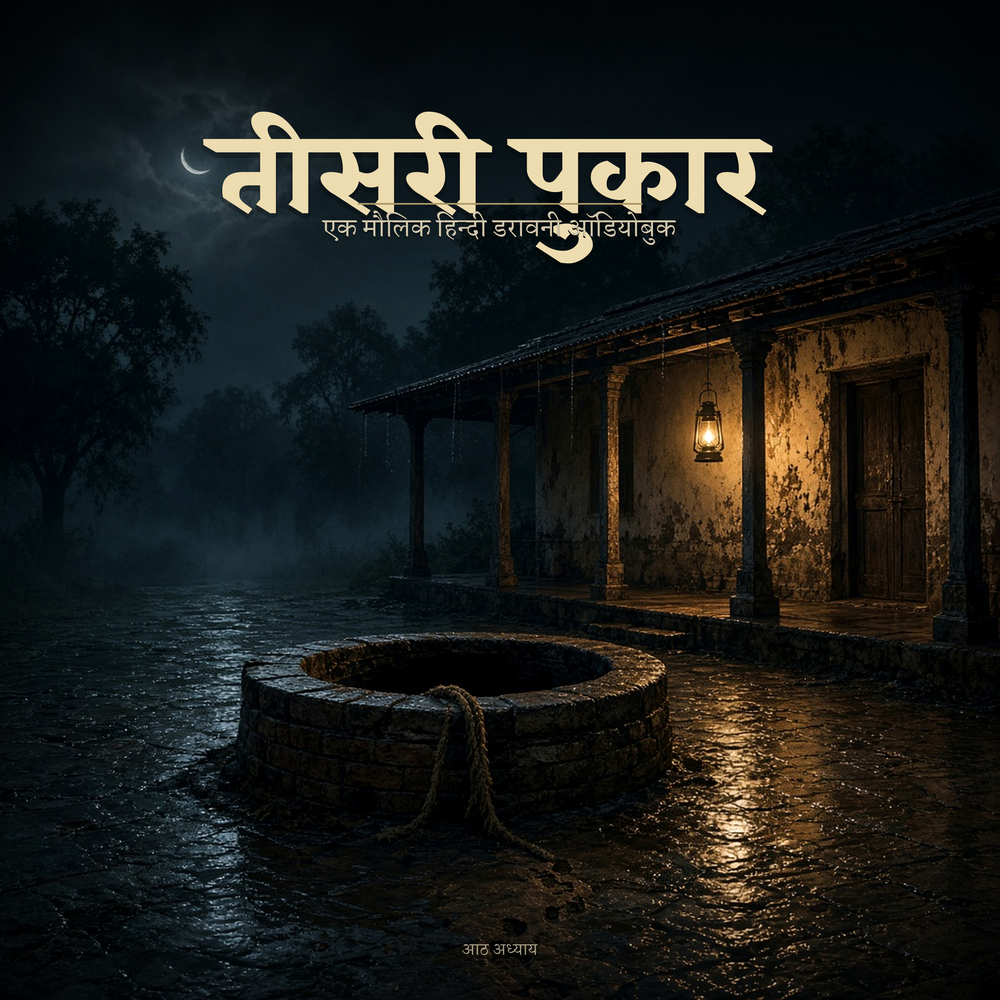

# तीसरी पुकार · Teesri Pukar

  

**HM Kahaniyan** · Hindi horror audio series · Ongoing

**Tagline:** जो तीसरी पुकार का उत्तर देता है, सुबह उसकी खड़ाऊँ मुंडेर पर मिलती है — शरीर नहीं।

- **Listen on Spotify:** [तीसरी पुकार](https://open.spotify.com/show/6yPuAn00jpvxNZYNBRAfDT)
- **Preview:** [preview_60s.mp3](preview_60s.mp3) (60 seconds)
- **Scripts:** [Part 1](script_part1_hi.txt) · [Part 2](script_part2_hi.txt)
- **Voice cast:** [CAST.md](CAST.md)
- **SFX credits:** [SOURCES.md](SOURCES.md)
- **Full-book audio:** [GitHub Release v1.0](https://github.com/ashswin-git/hm-kahaniyan-audiobooks/releases/tag/v1.0)

## Status

Part 1 (chapters 1–8, **46:36**) and Part 2 (chapters 9–16, **51:22**) are published.
Together they run **1 hour 37 minutes 58 seconds**. **Part 3 is coming soon.**

यह एक जारी सीरीज़ है — कहानी अध्याय ८ या १६ पर खत्म नहीं होती।

## Synopsis (spoiler-free)

सिन्धुवाड़ा के पुराने प्राथमिक विद्यालय के पिछवाड़े एक वर्षों से बंद कुआँ है। अध्यापिका अन्वी अमावस की रात तीन पुकारों का नियम सुनती है: जो तीसरी पुकार का उत्तर देता है, सुबह उसकी खड़ाऊँ मुंडेर पर मिलती है — शरीर नहीं। पुकार अक्सर उसी के स्वर में आती है।

भाग २ में कहानी यहीं से चलती है। तारक बहन की खड़ाऊँ और डायरी के साथ गाँव में रहता है, कुआँ उसका नाम गिनने लगता है, और गाँव का पुराना समझौता धीरे-धीरे खुलता है। अध्याय १६ एक क्लिफहैंगर पर रुकता है — भाग ३ आने वाला है।

Behind the old primary school in Sindhuwada sits a well that has been sealed for years. On a moonless night, the teacher Anvi learns the rule of three calls: whoever answers the third call is found the next morning only as a pair of wooden sandals on the well’s parapet — never the body. The voice that calls often sounds like one’s own. Part 2 continues from that ending. Part 3 is coming soon.

## Chapters

### भाग १ · Part 1 (46:36)

| # | शीर्षक | Duration |
|---|---|---|
| 1 | छत की टप-टप | 5:47 |
| 2 | बंद कुआँ | 5:51 |
| 3 | तीन पुकार का नियम | 5:59 |
| 4 | अमावस | 6:02 |
| 5 | अपना ही स्वर | 5:38 |
| 6 | गीली सीढ़ियाँ | 5:07 |
| 7 | हाँ, मैं हूँ | 5:20 |
| 8 | चाक की खड़ाऊँ | 6:52 |

### भाग २ · Part 2 (51:22)

| # | शीर्षक | Duration |
|---|---|---|
| 9 | उसका अपना नाम | 6:22 |
| 10 | नई दीदी | 6:18 |
| 11 | कई जोड़ी खड़ाऊँ | 5:50 |
| 12 | रजिस्टर की तिथि | 6:31 |
| 13 | माँ की चुप्पी | 6:36 |
| 14 | अधूरी हाँ | 5:56 |
| 15 | दो नाम | 5:51 |
| 16 | अपनी ही खड़ाऊँ | 7:59 |

## Voice cast

| Role | Voice |
|---|---|
| कथावाचक | Devansh |
| अन्वी / पुकार | Shalini |
| तारक / प्रतिध्वनि | Tushar |
| रघुनाथ | Raghavan |
| हरिकांत | Devendra |
| कमला | Kavita |
| रमेश | Kunal |
| रेणुका | Neha |
| सुमित्रा | Usha |
| यादव | Ishan |
| धीरजा | Priti |

See [CAST.md](CAST.md) for the full table.

## Licence

Story, script, mixed audio and cover: **All Rights Reserved © 2026 HM Kahaniyan**.  
Sound effects: CC0 / public domain, credited in [SOURCES.md](SOURCES.md).

Back to the [catalog README](../../README.md).
